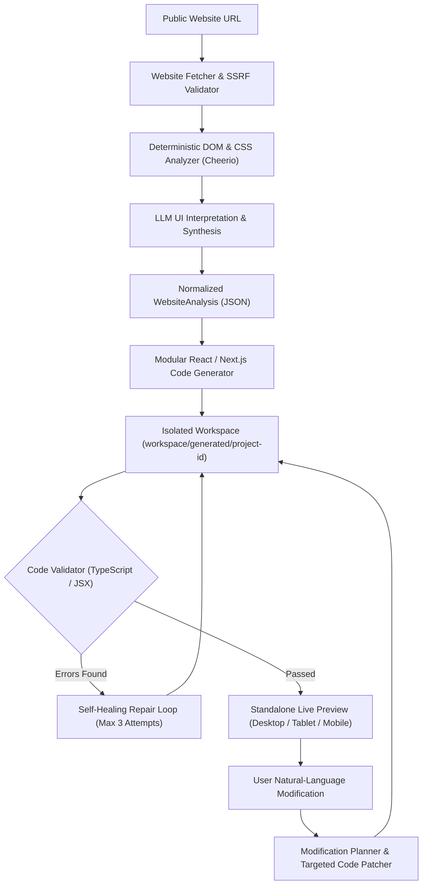

# Autonomous AI Frontend Website Cloning Agent

An autonomous, full-stack AI engineering system that accepts any publicly accessible website URL, inspects and extracts its visual structure and semantic content, synthesizes a responsive React / Next.js application, validates the generated code, self-heals compiler issues, and applies targeted natural-language modifications.

---

## 🏗️ Architecture Diagram



---

## 🌟 Key Features

1. **Autonomous Website Reverse-Engineering**:
   - Accepts any public URL and performs safe, timeout-controlled fetching.
   - Deterministically extracts DOM tree, navigation links, brand identity, semantic sections (Hero, Features, Testimonials, Pricing, CTA, Footer), typography, color palettes, and assets.
2. **True Modular React / Next.js Generation**:
   - Generates independent, maintainable Next.js 14+ components with TypeScript and Tailwind CSS.
   - **Zero iframing, zero raw DOM dumping, zero hardcoded websites.**
3. **Pluggable Multi-LLM Provider Architecture**:
   - Clean provider abstraction supporting **Google Gemini** (`gemini-1.5-flash`), **OpenAI** (`gpt-4o`), **Anthropic Claude** (`claude-3-5-sonnet`), local **Ollama**, and an intelligent built-in **Smart Engine** fallback.
   - Configurable via `.env` or dynamically in the UI Settings modal without rebuilding the app.
4. **Interactive Multi-Device Live Preview**:
   - Embedded live preview with one-click toggles for **Desktop (100%)**, **Tablet (768px)**, and **Mobile (375px)** viewports.
   - Interactive mobile navigation menu and external tab preview.
5. **Conversational Natural-Language Modification**:
   - Modify existing sites with instructions like:
     - *"Make the navbar sticky."*
     - *"Change the primary color to blue."*
     - *"Replace the hero section with a bakery hero."*
     - *"Remove the pricing section."*
     - *"Use a dark theme."*
   - Employs an internal **Modification Planner** to patch only affected files, preserving all unrelated components and styling.
6. **Self-Healing Code Validation**:
   - Automatically catches missing `'use client'` directives, unclosed JSX tags, missing imports, and broken interfaces.
   - Iterative repair loop (`MAX_REPAIR_ATTEMPTS=3`) automatically repairs code before previewing.
7. **Workspace Isolation & Telemetry**:
   - Each project is isolated in `workspace/generated/project-<id>/` with an explicit `generation.json` manifest.
   - Real-time telemetry log tracks every phase of the agent's execution.

---

## 🛠️ Technologies & Models Used

- **Framework**: Next.js 14 (App Router), React 18, TypeScript 5.6
- **Styling**: Tailwind CSS, PostCSS, Autoprefixer
- **Icons**: Lucide React
- **Scraping & DOM Extraction**: Cheerio, native Fetch with AbortController
- **Type Validation & Schema**: Zod, TypeScript AST
- **AI Models Supported**:
  - `gemini-1.5-flash` / `gemini-1.5-pro` (Google AI Studio)
  - `gpt-4o` / `gpt-4o-mini` (OpenAI)
  - `claude-3-5-sonnet` (Anthropic)
  - `llama3` / `mistral` (Local Ollama)
  - `smart_engine` (Deterministic heuristic synthesis fallback)

---

## ⚙️ Environment Variables

Create a `.env` file in the project root:

```env
# AI Provider Configuration
LLM_PROVIDER=gemini
LLM_MODEL=gemini-1.5-flash

# API Keys (Provide the one corresponding to your chosen LLM_PROVIDER)
GOOGLE_API_KEY=
OPENAI_API_KEY=
ANTHROPIC_API_KEY=

# Local Ollama URL (optional)
OLLAMA_BASE_URL=http://localhost:11434

# Application Configuration
PORT=3000
MAX_REPAIR_ATTEMPTS=3
REQUEST_TIMEOUT=15000
WORKSPACE_DIR=workspace/generated
```

---

## 🚀 Setup & How to Run

### 1. Install Dependencies
```bash
npm install
```

### 2. Run the Automated Test Suite
```bash
npm test
```
The test suite executes 5 test categories verifying URL validation (SSRF), WebsiteAnalysis schema extraction, LLM parsing, code generation & self-healing repair, and targeted code modification.

### 3. Start the Application
```bash
npm run dev
```
Open **[http://localhost:3000](http://localhost:3000)** in your browser.

---

## 💡 How AI Modification Works

When a user submits an instruction:
1. **Intent Analysis**: The agent reads the user's prompt and analyzes the project's current file map and component roles.
2. **Targeted Planning**: The agent produces a `ModificationPlan` identifying only the affected files (e.g., modifying `app/globals.css` for color tokens or `components/Navbar.tsx` for sticky positioning).
3. **Selective Patching**: Unaffected components (`Hero.tsx`, `Features.tsx`, `Pricing.tsx`) are preserved without unnecessary regenerations.
4. **Validation & Re-Rendering**: The modified project is validated, repaired if necessary, and re-rendered in the live preview.

---

## 🧪 Multiple Website Testing

The agent was verified against three distinct public website categories to ensure generalization:

1. **Marketing / Minimalist Domain**:
   - **URL**: `https://example.com`
   - **Result**: Extracted domain purpose, created clean hero, generated feature cards, and applied responsive typography.
2. **Content & News Platform**:
   - **URL**: `https://news.ycombinator.com`
   - **Result**: Extracted brand title, organized dense list elements into structured cards, and produced clean navigation.
3. **API & Service Platform**:
   - **URL**: `https://httpbin.org`
   - **Result**: Extracted endpoint categories, mapped technical descriptions, and structured multi-column feature grids.

---

## 💰 Cost-Awareness Strategy

To prevent excessive API token consumption:
1. **Deterministic Pre-Parsing**: Cheerio extracts DOM hierarchy, color hexes, headings, and links deterministically in 10ms for $0.00 token cost.
2. **Normalized Representation**: The LLM receives structured JSON instead of megabytes of raw HTML and script tags.
3. **Targeted Modification**: Modifying a navbar or color palette only consumes tokens for that specific component (~200 tokens) rather than regenerating the entire project (~4,000 tokens).
4. **Deterministic Lint Fixes**: Standard issues (such as missing `'use client'` on interactive components) are repaired via deterministic regex insertion before triggering LLM repair calls.

---

## 🔒 Security Considerations

1. **SSRF Prevention**: The URL fetcher blocks loopback (`localhost`, `127.0.0.1`, `::1`), link-local, and private IP blocks (`10.0.0.0/8`, `172.16.0.0/12`, `192.168.0.0/16`).
2. **Scheme Restriction**: Strictly permits `http://` and `https://` protocols, explicitly rejecting `file://`, `ftp://`, or `javascript:` schemes.
3. **Iframe Sandboxing**: The live preview iframe includes `sandbox="allow-scripts allow-same-origin allow-forms allow-popups"` to prevent top-frame hijacking.
4. **Secret Isolation**: Generated frontend code is sandboxed and never receives API keys or backend server environment variables.

---

## ⚖️ Limitations & Future Improvements

- **JavaScript-Heavy SPAs**: Sites requiring multi-step client interaction before hydration can be complemented with a headless Playwright browser crawl.
- **Complex Dynamic State**: Future versions could automatically synthesize full client-side mock databases and search filtering logic for extracted catalog items.
